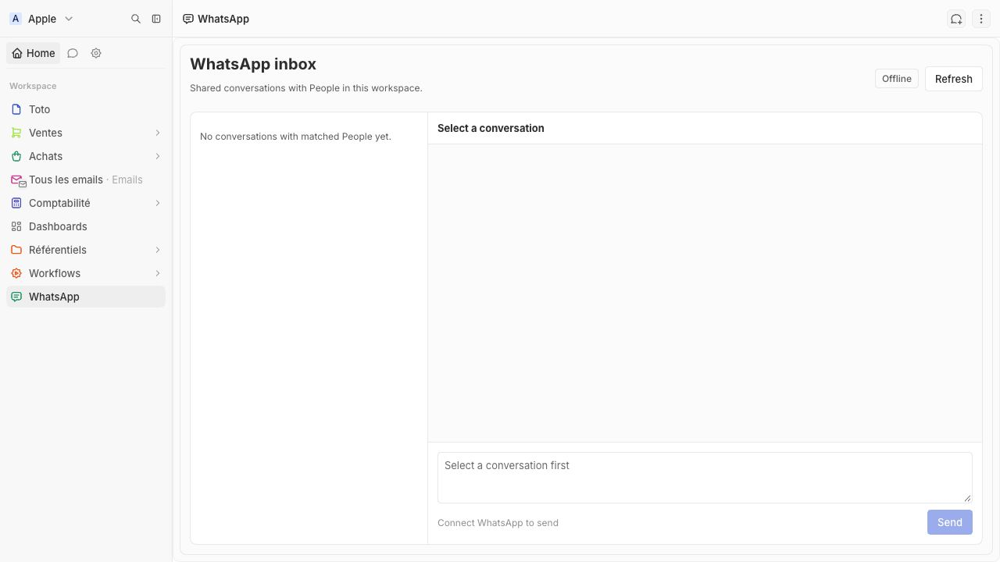

# WhatsApp for Twenty

A Twenty app built from the [in-product preview](docs/implementation.md). It uses a linked WhatsApp device through [Baileys](https://github.com/WhiskeySockets/Baileys), an unofficial WhatsApp Web client.

## Current milestone

The settings component has real QR pairing, connection status, reconnect, and disconnect controls. A separate Node bridge keeps the WebSocket alive and encrypts Baileys credentials and Signal keys at rest with AES-256-GCM. Only members with Twenty's APPLICATIONS permission can start or disconnect a session.

The bridge queues new direct and group messages in encrypted local files. A Twenty cron job imports direct chats after matching the other participant to exactly one existing Person, and imports group messages only after an admin selects that group. Available images and videos up to 64 MB are downloaded by the bridge and uploaded to the WhatsApp Message Files field in Twenty; media keys stay encrypted on the bridge. The app stores accounts, conversations, and messages in Twenty objects, with unique IDs for replay safety. Direct conversations link to a Person; group conversations retain the group title and message sender. The inbox and Person widget show stored threads, image previews, and playable videos, and allow manual text replies. A stable request ID prevents retrying an uncertain send as a new message.

Open inboxes use an authenticated held request to Twenty, which waits for the bridge to signal new messages, connection changes, or a completed send. The inbox then syncs and reloads; a 15-second retry is used only if the held request fails. The bridge grants one importer a short lease per queued batch so simultaneous open inboxes do not create duplicate messages. Each open inbox keeps one request outstanding while active; size the Twenty function workers accordingly for larger deployments.

This is a local development implementation synced to `localhost:2020`. New direct incoming and phone-sent texts have been verified in the Twenty inbox, and a message sent from Twenty was received on the contact's phone. Image and video import passes bridge tests and an app build; live media delivery still needs a real attachment test. Group discovery and import pass synthetic tests; live group message import has not yet been verified. The app matches primary Person phone numbers, including LID messages when WhatsApp shares the sender's phone number or a contact mapping is learned from a new incoming message. It does not import calls, other attachment types, view-once media, or direct LID messages without a phone mapping. The inbox currently loads the 50 most recent conversations and 200 most recent messages in a thread.

Once connected, the settings panel can review direct and group history. Choose a 30-day, 90-day, or all-available range, filter to Groups, load more candidates, select chats, and confirm before importing. Available images and videos are imported with selected messages. History remains encrypted in the local bridge until selected. Existing People are matched by primary phone; selected unmatched direct contacts can be named and created through the administrator's Twenty permissions. Group participants are not created as People. Message IDs prevent duplicates on retries. The bridge uses a browser identity for QR pairing because WhatsApp currently rejects Baileys' Desktop identity before it can show a QR. WhatsApp may send only part of the old history. Media descriptors discarded before this feature was added cannot be recovered from the bridge cache; WhatsApp must send those old messages again before their files can be imported. The [design preview](docs/import-history-settings-preview.html) still uses sample data.

This is a single-workspace local development slice. Do not deploy the bridge as a public service or connect a production number. WhatsApp may restrict or disconnect unofficial clients.

## Run with a local Twenty instance

Requirements: Node 24.5+, Twenty 2.45+, a running local Twenty instance at http://localhost:2020, and the Twenty app CLI authenticated to a remote named local.

    yarn install
    yarn twenty remote:use local
    yarn twenty dev --once
    cd bridge
    npm install
    cd ..
    node scripts/configure-local.mjs
    cd bridge
    npm run dev

The configure-local.mjs script generates bridge/.env (ignored by Git) with a random bridge token and encryption key, then sets the corresponding application variables **only** on the local Twenty remote at http://localhost:2020. The script reuses an existing .env; keep that file and the encrypted bridge/data directory together or the session and queued events cannot be restored. The bridge listens on 127.0.0.1:8765; Docker Desktop's host.docker.internal lets the local Twenty container reach it.

Keep `npm run dev` running in a dedicated terminal while using the app. If the bridge stops, Twenty reports it as unavailable. Restarting the bridge resumes a saved linked-device session automatically; a new QR scan is needed only if WhatsApp has logged the device out.

Open **Settings → Apps → WhatsApp → WhatsApp**, read the disclosure, check both acknowledgements, and choose **Show QR code**. Scan with a test phone under **WhatsApp → Linked devices → Link a device**. Disconnect in the same settings panel to remove the local auth state.

For a transport check that does not link a phone, run node bridge/scripts/check-qr.mjs from the repository root while the bridge is running and disconnected. It verifies QR generation and then cancels the pairing attempt. It refuses to run against an active session.

## Repository layout

- src/: Twenty objects, Person relation, settings and inbox front components, Person widget, and authenticated message routes.
- bridge/: persistent Baileys process with encrypted auth, event queue, selectable history cache, and send receipts.
- docs/: implementation design, interactive design previews, and screenshots from the earlier in-product preview.
- scripts/configure-local.mjs: local credential and application-variable setup.

## Remaining before production use

Add indexed phone matching for large workspaces, map LID identities without a shared phone number and additional Person numbers, add message status receipts and operational monitoring for the bridge. The full design and acceptance criteria are in [docs/implementation.md](docs/implementation.md).
