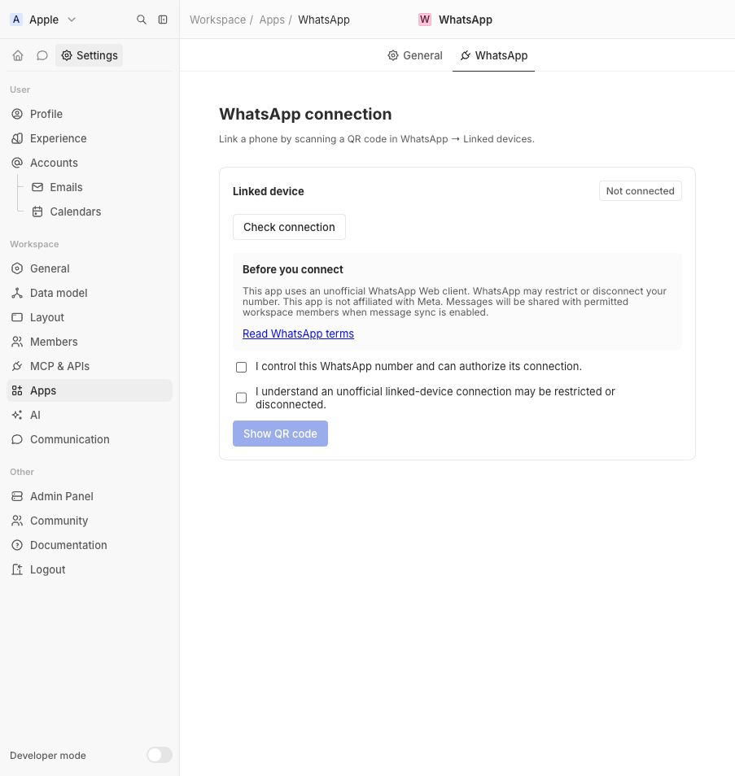
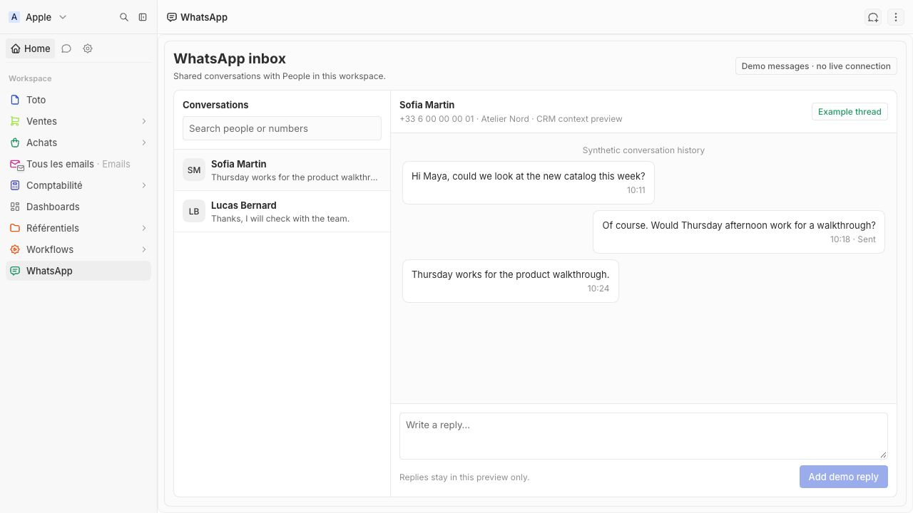
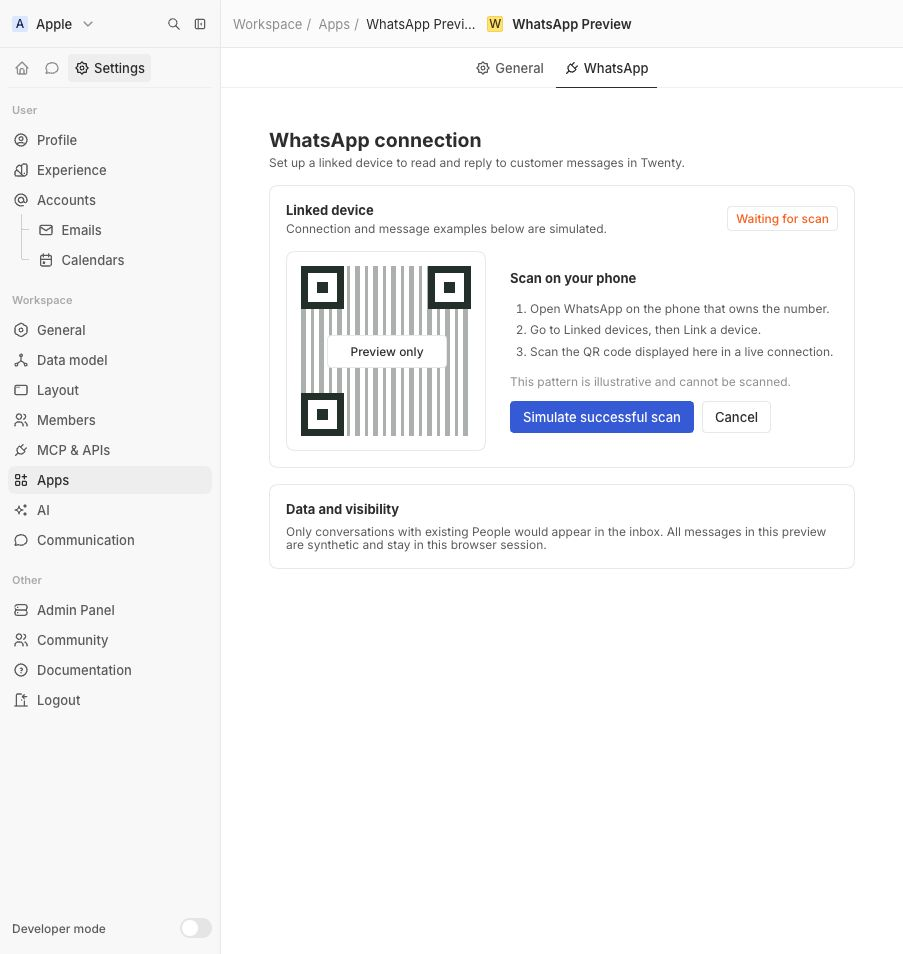
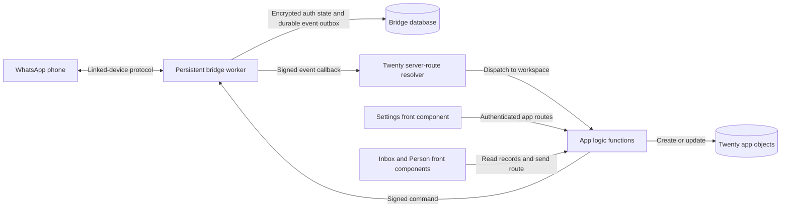
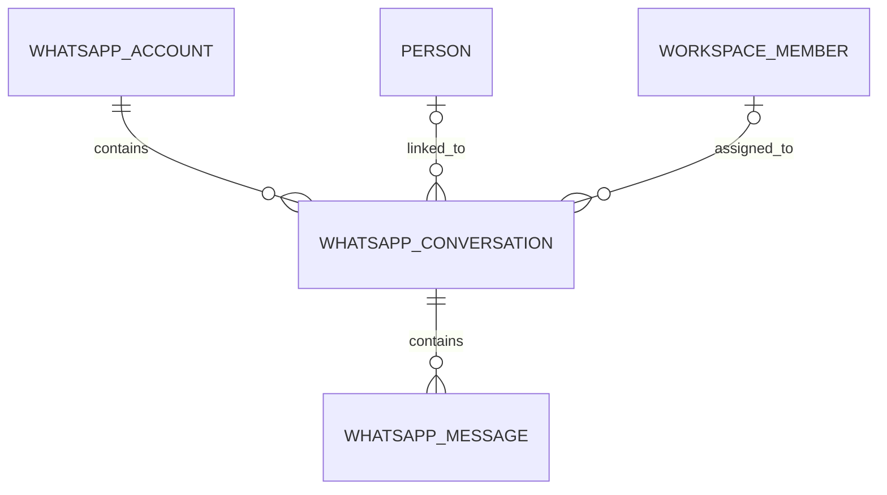
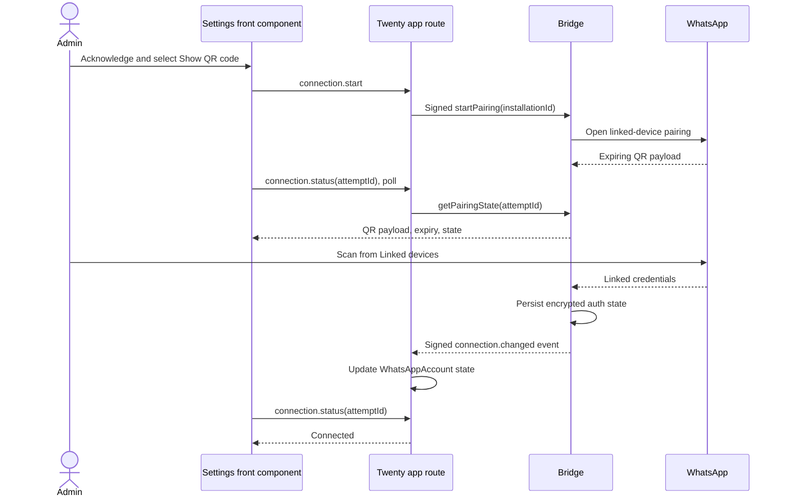
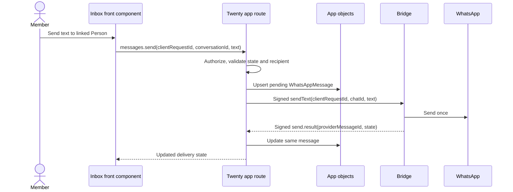
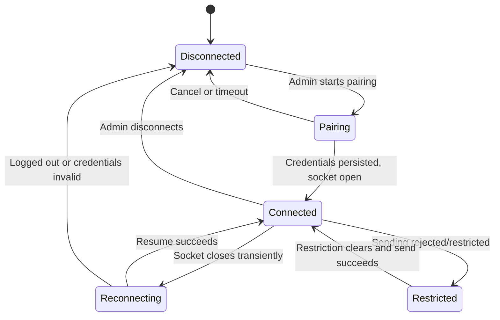

# WhatsApp linked-device app for Twenty

**Status:** Local text messaging verified; selective history import implemented, awaiting a fresh history sync for live verification · **Updated:** 14 October 2026 · **Design preview:** [Open the import settings mockup](./import-history-settings-preview.html)

## Current app inside Twenty

The [WhatsApp app](../README.md) is installed on the local Twenty instance at http://localhost:2020. Its settings component requests a real pairing QR from a persistent Baileys bridge. The bridge encrypts session credentials, Signal keys, queued text events, and send receipts at rest. Twenty stores matched incoming and phone-sent messages alongside manual replies in app objects, and the inbox and Person widget render the stored threads. Incoming text, phone-sent text, and a Twenty-sent message received on the contact's phone have been verified with the linked device.




The screenshots below show the earlier visual preview. They illustrate the intended layout and sample thread, not the current live behavior.





## Decision and scope

Build a Twenty app that lets a workspace admin connect one WhatsApp number from **Settings → WhatsApp** by scanning a QR code, then lets permitted members read and send one-to-one text messages in a shared WhatsApp inbox and on a Person record. The linked-device option targets personal WhatsApp numbers; Business numbers should use the official coexistence route when eligible. The QR pairs a separate, long-running WhatsApp Web client as a linked device. It is **not** a Meta Cloud API credential. This proposal uses Baileys as the concrete client and keeps it outside Twenty logic functions.

This is an unofficial integration. The UI must say so before pairing. An acknowledgement documents the user's choice; it does not authorize the integration under WhatsApp's terms or guarantee account availability. WhatsApp may restrict automated access or sending, and lemlist documents temporary restrictions on its own WhatsApp Web campaign sends. [WhatsApp terms](https://www.whatsapp.com/legal/terms-of-service), [lemlist restrictions](https://help.lemlist.com/en/articles/15825642-fix-whatsapp-campaign-messages-blocked-by-a-temporary-meta-ban).

The first release supports one connected number per workspace, manual text messages, existing Twenty People, and a workspace-shared inbox. The schema and bridge should allow multiple numbers later. It does not send campaigns, bulk messages, group messages, calls, or new-chat outreach in v1. Media received in a conversation appears as an unsupported-content placeholder; media sending is a later slice. Unmatched incoming chats are not stored by default. The admin can later opt in to an unmatched inbox after the privacy and access model is implemented.

The official alternative is Meta Embedded Signup with WhatsApp Business app coexistence. It can also present a QR code, but that QR authorizes Cloud API access rather than linking a WhatsApp Web device. HubSpot uses this flow. It is the preferred future provider for Business numbers; it cannot replace the proposed personal-account flow. [HubSpot coexistence](https://knowledge.hubspot.com/inbox/connect-a-whatsapp-number-to-hubspot-using-coexistence), [Meta Embedded Signup](https://www.postman.com/meta/whatsapp-business-platform/documentation/du6gzjv/embedded-signup).

## Product references

| Product | Observed pattern | What to use in Twenty |
| --- | --- | --- |
| [Attio / TimelinesAI](https://attio.com/apps/timelinesai-whatsapp-integration) | A marketplace app links WhatsApp activity to People and offers an in-record send action. The WhatsApp transport is provided by TimelinesAI. | Put the conversation beside the Person record; keep provider transport separate from CRM records. |
| [Salesforce](https://help.salesforce.com/s/articleView?id=release-notes.rn_service_enhanced_whatsapp.htm&language=en_US&release=242&type=5) | WhatsApp enters a service console as messaging sessions handled by agents. | Make ownership, status, and thread context visible in the inbox. |
| [HubSpot](https://knowledge.hubspot.com/inbox/connect-a-whatsapp-number-to-hubspot-using-coexistence) | An admin connects a Business number; WhatsApp threads appear in inbox/help desk and sync in both directions. | A single connection settings surface and a shared conversation list. Keep official coexistence as a separate provider choice. |
| [Lemlist](https://help.lemlist.com/en/articles/15825628-how-to-connect-whatsapp-to-lemlist) | A guided risk/practices flow precedes a Linked devices QR. Its [inbox](https://help.lemlist.com/en/articles/10035229-use-the-lemlist-inbox) offers channel filtering and replies. | Show precise consent before pairing; include connection health, channel filtering, and a reply composer. |

These are product references, not evidence that the four products use the same WhatsApp transport. Attio's listing is a third-party app; HubSpot's QR is official coexistence; lemlist's documented QR uses Linked devices.

## User experience

The [interactive design preview](./design-preview.html) has four states: pre-connection, QR pairing, connected settings, and inbox. It is a visual specification with synthetic content and a non-scannable QR illustration.

1. **Settings, before pairing.** Show what will sync, who can see it, account restriction/disconnection risk, and a link to WhatsApp's terms. Require two separate acknowledgements: the user controls the number; the user understands this uses an unofficial linked-device connection. No “safe sending” promise.
2. **Pairing.** On **Show QR code**, create a short-lived pairing attempt. Render the bridge-provided QR payload, expiry countdown, and phone instruction: WhatsApp → Linked devices → Link a device. Refresh on expiry without asking for the disclosures again within that attempt. Never persist or log QR payloads.
3. **Connected settings.** Show number, owner, last successful connection, sync scope, health (`Connected`, `Reconnecting`, `Restricted`, `Disconnected`), a **Reconnect** action, and **Disconnect**. When sending is blocked, say whether receiving and replies remain available if the bridge can determine that reliably; otherwise say “Sending unavailable.”
4. **Inbox.** Show a conversation list sorted by last activity, unread state, assigned member, Person link, full chronological message history, timestamps, delivery state, and a text composer. Search/filter by Person, number, assigned member, and unread. Disable Send while the account is disconnected or restricted. An error should leave the draft in place.
5. **Person record.** Add a `WhatsApp conversations` front-component widget to the Person record page and an in-record **Open WhatsApp** action. It opens the same thread; the record and inbox must never maintain separate message copies.

The design uses Twenty's light surfaces and spacing, with green reserved for the WhatsApp connection and send action. Use `IconMessage` for conversations per the [icon dictionary](https://github.com/twentyhq/twenty/blob/main/packages/twenty-ui/src/icon/icon-dictionary.md); import production icons from `twenty-ui/icon`. User-facing strings in production use Lingui. The HTML preview is design reference, not production component code.

## Architecture



**Bridge module interface:** `startPairing`, `getPairingState`, `sendText`, `disconnect`; outbound events are `connection.changed`, `message.received`, `message.updated`, and `send.result`. The bridge hides QR rotation, socket reconnects, Signal key persistence, event replay, and the client library. It owns no CRM matching rules. A future Cloud API adapter can satisfy a higher-level message transport interface only when it actually exists; do not add a speculative provider abstraction to v1.

The bridge needs a persistent Node process and durable storage. A Twenty logic function has a bounded execution time and cannot own the long-lived socket. Use one active worker lease per account, reconnect with backoff, and persist credential/key updates before acknowledging them. Baileys advises a database-backed auth store for production; its example multi-file store is not appropriate for a multi-tenant service. [Baileys session management](https://github.com/WhiskeySockets/docs/blob/main/authentication/session-management.mdx), [Baileys troubleshooting](https://github.com/WhiskeySockets/docs/blob/main/advanced/troubleshooting.mdx).

**Twenty-side module interface:** authenticated routes `connection.start`, `connection.status`, `connection.disconnect`, and `messages.send`; signed bridge events enter one server-route resolver, which identifies the installation and dispatches to the owning workspace. Keep transport-specific event parsing in one ingestion module. The UI reads app objects through `twenty-client-sdk` and uses the same authenticated send route from inbox and Person view.

This mirrors existing repo capabilities: [Settings menu items](https://github.com/twentyhq/twenty/blob/main/packages/twenty-apps/public/last-contact/src/settings-menu-items/last-contact-settings.ts) point to a front component; [front components](https://github.com/twentyhq/twenty/blob/main/packages/twenty-apps/public/fireflies/src/front-components/settings.front-component.tsx) render app settings; [standalone page layouts](https://github.com/twentyhq/twenty/blob/main/packages/twenty-apps/internal/real-estate/src/page-layouts/agency-dashboard.page-layout.ts) can host an inbox widget; [record page widgets](https://github.com/twentyhq/twenty/blob/main/packages/twenty-apps/fixtures/rich-app/src/page-layout-widgets/extra-widget.page-layout-widget.ts) can host the Person view. [Authenticated app routes](https://github.com/twentyhq/twenty/blob/main/packages/twenty-apps/public/discord/src/logic-functions/discord-post-message-route.ts) and [signed external callbacks](https://github.com/twentyhq/twenty/blob/main/packages/twenty-apps/public/slack/src/logic-functions/slack-events-resolver.ts) are existing patterns.

### Why app objects instead of Twenty's native Message object

The current `createMessageChannel` SDK call requires a `connectedAccountId`, and the server verifies that this is an account belonging to the app. [Connection providers](https://github.com/twentyhq/twenty/blob/main/packages/twenty-sdk/src/sdk/define/connection-providers/define-connection-provider.ts) currently support only `oauth`; QR pairing creates no such connected account. [Channel creation](https://github.com/twentyhq/twenty/blob/main/packages/twenty-sdk/src/sdk/logic-function/messaging/create-message-channel.ts) therefore cannot be used directly by a QR-only app. The v1 design stores conversations and messages in app objects. A later core change could add a non-OAuth connected account/connection provider and allow native `ingestMessages`; that is an explicit separate project, not an assumed dependency.

## Data model



| Object | Fields and invariants |
| --- | --- |
| `WhatsAppAccount` | `id`, E.164 `phoneNumber`, `displayName`, `ownerWorkspaceMemberId`, `bridgeInstallationId`, `state`, `lastConnectedAt`, `lastErrorCode`, `syncScope`, `acknowledgementVersion`, `acknowledgedAt`. Unique `(workspace, phoneNumber)`. **No QR payload or session keys.** |
| `WhatsAppConversation` | `id`, relation to Account, provider `chatId`, optional relation to Person, optional assignee, `lastMessageAt`, `lastMessagePreview`, `unreadCount`, `status`. Unique `(accountId, chatId)`. Use provider chat identity as the durable key; an E.164 number alone is insufficient for all WhatsApp identity forms. |
| `WhatsAppMessage` | `id`, relation to Conversation, provider `messageId`, `direction`, `senderHandle`, `text`, `contentType`, `sentAt`, `deliveryState`, `errorCode`, `clientRequestId`. Unique `(conversationId, providerMessageId)` for received/confirmed messages and unique `clientRequestId` for app sends. Store normalized text and minimal provider identifiers, not entire raw payloads. |

Use `defineObject`, `defineField`, and `defineIndex` in the app, following existing [object](https://github.com/twentyhq/twenty/blob/main/packages/twenty-apps/fixtures/rich-app/src/objects/recipient.object.ts), [relation](https://github.com/twentyhq/twenty/blob/main/packages/twenty-apps/fixtures/rich-app/src/fields/post-card-recipients-on-recipient.field.ts), and [unique index](https://github.com/twentyhq/twenty/blob/main/packages/twenty-apps/public/slack/src/indexes/slack-user-link-slack-user.index.ts) examples. The bridge's own database stores encrypted credentials, active connection lease, pairing attempts, and a durable outbound event queue. Twenty is the source of truth for CRM conversation records; the bridge is the source of truth for the live WhatsApp session.

Person matching resolves the provider's phone-number identity, normalizes both sides to E.164, and links only an unambiguous match. The bridge must preserve both the provider chat ID and any phone-number mapping; it must not treat a linked-device ID as an E.164 number. A duplicate phone number in People leaves the conversation unlinked for manual resolution. In the default `CRM contacts only` scope, drop unmatched message content before CRM persistence and count only anonymized diagnostics. Do not create People automatically in v1. A future `All incoming conversations` option needs a separate permission and retention review.

## Pairing and message contracts



Use fixed, authenticated `/s/whatsapp/connection/start`, `/status`, `/disconnect`, and `/messages/send` routes. The front component calls them with `RestApiClient`, as the existing [Slack settings hook](https://github.com/twentyhq/twenty/blob/main/packages/twenty-apps/public/slack/src/front-components/hooks/use-slack-connection-status.ts) does. The `status` response contains a QR payload only while a pairing attempt is active; it must never contain credentials. A user-scoped route must enforce admin rights on connect/disconnect and message permission on send, using `RoutePayload.userWorkspaceId` plus app role checks. Do not rely only on the presence of a bearer token.

The bridge signs callback **raw body + timestamp + installation ID** with a per-installation secret. The Twenty server-route resolver checks the signature in constant time, rejects stale timestamps and duplicate event IDs, then maps the opaque installation ID to a workspace and dispatches the event. Twenty's [Fireflies webhook](https://github.com/twentyhq/twenty/blob/main/packages/twenty-apps/public/fireflies/src/logic-functions/fireflies-webhook.ts) shows raw-body/HMAC handling; its [Slack resolver](https://github.com/twentyhq/twenty/blob/main/packages/twenty-apps/public/slack/src/logic-functions/slack-events-resolver.ts) shows workspace dispatch. The installation mapping can use app server-scoped key-value storage, as Slack does. Provision and rotate the per-installation secret during install/connection setup. Never place it in a front component.



The `clientRequestId` is generated before sending and reused on retries. The bridge maintains an idempotency record; a timeout after WhatsApp accepts a send must remain `unknown` until reconciliation, not trigger a second send. Inbound callbacks upsert by `(conversationId, providerMessageId)`, update the conversation summary, and may be replayed safely. Acknowledge bridge events only after Twenty persistence succeeds. Preserve chronological order by provider timestamp with a deterministic tie-breaker. Treat read/delivery receipts as optional status updates, never as a guarantee.

## Connection state and failure behavior



The bridge emits an account state change on every transition. The UI never infers “healthy” merely because it has a saved session. A logged-out session requires a new QR. A transient disconnect retries with backoff; a restriction pauses sends and surfaces the provider error. Keep the draft and show a retry action only when it cannot produce a duplicate. On uninstall, revoke the linked device where possible, delete bridge credentials and secrets, stop callbacks, and let the workspace choose whether to retain or delete CRM records. On ordinary disconnect, default to retaining CRM history while making the deletion option explicit.

## Security and privacy requirements

- Store credentials and Signal keys encrypted at rest in the bridge, partitioned per installation. Decrypt only in the active worker; never write them to Twenty objects, logs, support tickets, browser storage, or the QR response. A leaked auth state can hijack a linked session. [Baileys security guidance](https://github.com/WhiskeySockets/Baileys/security).
- Enforce one active worker lease per account and use durable key writes. A process crash must not lose a key update or send a pending message twice. [Baileys session management](https://github.com/WhiskeySockets/docs/blob/main/authentication/session-management.mdx).
- Limit the default sync to known CRM People. The bridge still has access to the linked account's incoming events, so filtering limits what Twenty stores, not what the bridge can technically see. The app is workspace-shared, so the settings disclosure must name who can read the stored messages. Later personal/private inbox support needs actual record access control, not only a UI filter.
- Keep a versioned acknowledgement record (member, number, timestamp, copy version) and a visible **Disconnect** action. Avoid “safe,” “approved,” or “guaranteed” language. The terms risk remains after acknowledgement. [WhatsApp terms](https://www.whatsapp.com/legal/terms-of-service).
- Validate E.164 numbers, outbound body length, workspace membership, and account ownership server-side. Redact message bodies, phone numbers, QR payloads, and session material from operational logs; retain only event IDs, failure codes, and aggregate metrics.

## Build order and acceptance

Proposed implementation locations:

```text
twenty-whatsapp/
  src/application.config.ts
  src/settings-menu-items/whatsapp-settings.ts
  src/front-components/settings.front-component.tsx
  src/front-components/inbox.front-component.tsx
  src/front-components/person-conversation.front-component.tsx
  src/page-layouts/whatsapp-inbox.page-layout.ts
  src/page-layout-widgets/person-whatsapp.page-layout-widget.ts
  src/objects/whatsapp-account.object.ts
  src/objects/whatsapp-conversation.object.ts
  src/objects/whatsapp-message.object.ts
  src/fields/ and src/indexes/
  src/logic-functions/connection-*.ts
  src/logic-functions/message-*.ts
  src/logic-functions/bridge-events-resolver.ts
  src/logic-functions/handlers/
  bridge/ (separately deployed Node process and durable store)
```

The bridge may live in its own package or repository if deployment ownership differs; the path above shows the source relationship, not a requirement to run it inside Twenty's app runtime.

1. **Transport spike:** on a test number, prove QR rotation, successful pairing, restart without rescanning, inbound text, outbound text, logout, and disconnect. Measure the hosting and persistent-session cost. Do not connect a production number for this spike.
2. **Twenty shell:** create app manifest, role, settings menu item/front component, standalone inbox page layout and widget, Person record widget, three app objects, relations, and unique indexes. Confirm that page-layout widgets and the chosen Twenty client SDK methods work in the front-component sandbox.
3. **Pairing:** implement authenticated start/status/disconnect routes, signed bridge commands, HMAC callback resolver, versioned disclosures, QR expiry, and reconnect UI.
4. **Messages:** implement contact matching, inbound upsert, manual send with idempotency, status callbacks, inbox list/thread/composer, and Person view. Use a durable bridge event outbox and replay.
5. **Hardening:** per-workspace authorization, session encryption/rotation, disconnect/uninstall cleanup, failure states, metrics, and focused integration tests.

Release acceptance: an admin can pair and reconnect one test number; a known Person's inbound text appears once in the inbox and on their record; a permitted member can reply once even after a simulated timeout/retry; a different workspace cannot view or send through the account; an unknown sender's content is not stored in default scope; a lost session disables Send and offers a fresh QR; disconnect removes bridge credentials; UI never shows a scannable QR after pairing or expiry.

## Decisions to settle before coding

| Decision | Proposed v1 answer |
| --- | --- |
| Sharing | Workspace-shared inbox, connected by an admin; no personal account privacy promise. |
| Initial history | Available one-to-one text history is cached encrypted by the bridge and imported only after an administrator selects chats and confirms sharing. WhatsApp may not replay old history to an already-linked session; a fresh QR link may be needed. |
| Unknown senders | No CRM persistence in default `CRM contacts only` mode. |
| Outbound | Manual one-to-one replies to a linked Person only; no campaigns or cold outreach. |
| Hosting | Separate bridge deployment with persistent worker, database, encryption key, and event outbox. |
| Official provider | Separate future Cloud API/coexistence integration for WhatsApp Business numbers. |

The transport spike is the go/no-go gate. A polished disclaimer cannot make the protocol stable or permitted; if the account restriction rate or reconnect burden is unacceptable, use the official Business Platform route instead.
